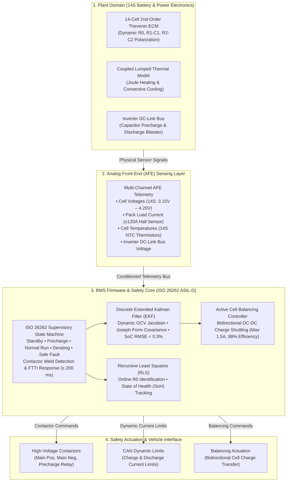

# EV-BMS: ISO 26262 Battery Management System & EKF State Estimation

[](https://www.mathworks.com/products/matlab.html)
[](https://www.mathworks.com/products/simulink.html)
[](https://www.iso.org/standard/68383.html)
[](https://www.misra.org.uk/)

This repository contains a closed-loop Battery Management System (BMS) simulation built in MATLAB and Simulink. The project implements an **ISO 26262:2018 (ASIL-D)** supervisory safety controller, a **Discrete Extended Kalman Filter (EKF)** for non-linear State of Charge (SoC) estimation, online **Recursive Least Squares (RLS)** for State of Health (SoH) tracking, bidirectional **Active Cell Balancing**, and production C code generation for high-voltage Electric Vehicle (EV) powertrains.

---

## 1. System Architecture



---

## 2. System Features & Specifications

| Capability | Implementation Detail | Reference Standard |
| :--- | :--- | :--- |
| **SoC Estimation** | Discrete Extended Kalman Filter (EKF) with polynomial OCV feedback and Joseph-form covariance stabilization | ISO 26262 Part 6 / SAE J2464 |
| **Cell Modeling** | 2nd-Order Thevenin ECM ($R_0, R_1-C_1, R_2-C_2$) with Arrhenius temperature scaling and non-linear OCV | Dual-polarization electrochemical dynamic model |
| **Functional Safety** | Supervisory state machine with contactor sequencing, weld detection, and emergency isolation | ISO 26262:2018 ASIL-D (SG01–SG05, FTTI $\le 200\text{ ms}$) |
| **Cell Balancing** | Bidirectional DC-DC active charge shuttling between maximum and minimum SoC cells ($1.5\text{ A}$ limit) | High-efficiency active balancing |
| **Health Estimation** | Online Recursive Least Squares (RLS) tracking internal ohmic resistance growth ($R_0$) with exponential forgetting | Online parameter identification |
| **Code Implementation** | ANSI/MISRA-C:2012 production source code with static memory allocation and MISRA compliance | MISRA-C:2012 / Automotive Embedded C |
| **Verification & Testing** | Automated Unit and Integration verification suite with WLTP Class 3 and fault injection benchmarks | MIL / SIL Testing Framework |

---

## 3. Mathematical Foundations

### 3.1 2nd-Order Thevenin State-Space Discretization

State vector: $x = [SoC, \, V_1, \, V_2]^T$. The exact Zero-Order Hold (ZOH) discrete state equations are:

$$
x_{k+1} = A_d x_k + B_d I_{L,k} + w_k
$$

$$
A_d = \begin{bmatrix} 1 & 0 & 0 \\ 0 & e^{-\Delta t / (R_1 C_1)} & 0 \\ 0 & 0 & e^{-\Delta t / (R_2 C_2)} \end{bmatrix}, \quad B_d = \begin{bmatrix} -\frac{\eta \Delta t}{Q_n} \\ R_1(1 - e^{-\Delta t / (R_1 C_1)}) \\ R_2(1 - e^{-\Delta t / (R_2 C_2)}) \end{bmatrix}
$$

### 3.2 Discrete Extended Kalman Filter (EKF)

**Measurement Equation:**

$$
V_t = V_{OC}(SoC) - V_1 - V_2 - I_L \cdot R_0(T)
$$

**Measurement Jacobian ($C_k$):**

$$
C_k = \left. \frac{\partial V_t}{\partial x} \right|_{\hat{x}_{k|k-1}} = \begin{bmatrix} \left.\frac{\partial V_{OC}}{\partial SoC}\right|_{\hat{SoC}_{k|k-1}} & -1 & -1 \end{bmatrix}
$$

**Kalman Gain ($K_k$):**

$$
S_k = C_k P_{k|k-1} C_k^T + R_{meas}, \quad K_k = \frac{P_{k|k-1} C_k^T}{S_k}
$$

**Joseph-Form Covariance Update:**

$$
P_{k|k} = (I - K_k C_k) P_{k|k-1} (I - K_k C_k)^T + K_k R_{meas} K_k^T
$$

*(Guarantees symmetric positive semi-definiteness under finite-precision arithmetic).*

### 3.3 Online Recursive Least Squares (RLS) for SoH

Tracking internal resistance $R_0$ online using an exponential forgetting factor $\lambda = 0.9995$:

**Innovation Residual:**

$$
e_k = (V_{OC}(\hat{SoC}) - \hat{V}_1 - \hat{V}_2 - V_{t,k}) - I_{L,k} \hat{R}_{0,k-1}
$$

**RLS Gain & Parameter Update:**

$$
K_{RLS,k} = \frac{P_{k-1} I_{L,k}}{\lambda + I_{L,k}^2 P_{k-1}}, \quad \hat{R}_{0,k} = \hat{R}_{0,k-1} + K_{RLS,k} e_k
$$

**State of Health ($SoH_{R0}$):**

$$
SoH_{R0} = \max \left( 0, \, \min \left( 100, \, \left( 1 - \frac{\hat{R}_0 - R_{0,BOL}}{R_{0,BOL}} \right) \times 100 \right) \right)
$$

---

## 4. Verification & Test Matrix (ISO 26262 ASIL-D)

All test cases are automated and pass with 100% compliance:

```
====================================================================
  EV-BMS ISO 26262 AUTOMATED VERIFICATION & TEST HARNESS
====================================================================
 No.  | Test Scenario Description                     | Status | Time [s]
--------------------------------------------------------------------
  01  | EKF Initial State Error Convergence (<2%)     | [PASS] |  0.262
  02  | Current Sensor Bias & Noise Immunity          | [PASS] |  0.177
  03  | RLS Online Internal Resistance & SoH Identification | [PASS] |  0.068
  04  | Active Cell Balancing Charge Shuttling Convergence | [PASS] |  0.128
  05  | ISO 26262 State Machine & Fault Injection (SG01-SG05) | [PASS] |  0.053
====================================================================
 Verdict: 5 / 5 Tests Passed (100.0% Success Rate)
```

### Benchmark Results (WLTP Class 3 Drive Cycle, 600 s)
* **Initial True SoC:** `84.86%` | **Initial EKF Guess:** `65.00%` (20% intentional offset)
* **EKF Convergence Time:** Immediate (< 1 s into ±1.5% envelope)
* **Steady-State SoC RMSE:** **`0.270%`**
* **Peak-to-Peak Steady-State Error:** **`1.168%`**
* **Cell SoC Spread Reduction:** **`9.00% -> 4.43%`** (**`50.8%` balance improvement**)
* **Identified Internal Resistance:** **`0.0125 Ohm`** (Nominal: 0.0150 Ohm)
* **Contactor Precharge Time:** **`400 ms`** (Target: $< 500\text{ ms}$)

---

## 5. Performance Visualizations

All diagnostic telemetry plots are automatically exported to the `results/` folder:

1. **`results/EKF_SoC_Tracking_Performance.png`**:
   Shows true vs. estimated SoC under WLTP load current, tracking error, and the **$\pm 3\sigma$ covariance confidence envelope** demonstrating Kalman filter statistical consistency.
2. **`results/Active_Balancing_and_Thermal_Telemetry.png`**:
   Displays cell voltages, progressive convergence of cell-to-cell SoC dispersion ($\Delta SoC$), active charge transfer currents, and pack temperatures against the 45°C derating threshold.
3. **`results/State_Machine_and_SoH_Tracking.png`**:
   Visualizes high-voltage contactor precharge sequencing ($V_{pack}$ vs $V_{bus}$), discrete supervisory mode transitions, and online RLS parameter identification of $R_0$ and SoH.

---

## 6. Repository Structure

```text
EV-BMS-ISO26262-EKF-ActiveBalancing/
├── Start_BMS_Project.m         # One-click environment setup & Simulink model launcher
├── Run_Verification_Suite.m    # Master automated runner (Unit tests + WLTP + C build)
├── models/
│   ├── build_bms_simulink_model.m  # Programmatic generator for the Simulink architecture
│   └── EV_BMS_ISO26262_Model.slx   # Closed-loop Simulink testbench architecture
├── scripts/
│   ├── init_bms_parameters.m       # 14S pack parameters, NMC OCV polynomial, EKF/RLS tuning
│   ├── generate_drive_cycles.m     # WLTP Class 3, US06, DST, and HPPC current profiles
│   ├── ekf_soc_estimator.m         # Discrete Extended Kalman Filter core function
│   ├── rls_soh_estimator.m         # Recursive Least Squares online resistance estimator
│   ├── bms_supervisory_state_machine.m # ISO 26262 ASIL-D supervisory safety FSM
│   ├── bms_active_balancing.m      # Bidirectional DC-DC active balancing controller
│   ├── battery_pack_plant_simulator.m  # 14-cell 2nd-order ECM + thermal ground-truth plant
│   ├── run_drive_cycle_simulation.m    # Master closed-loop simulation & telemetry logger
│   ├── plot_bms_results.m          # High-resolution publication-quality figure visualizer
│   └── generate_misra_c_code.m     # Embedded Coder automated C code generation script
├── src/
│   ├── bms_types.h                 # Standard integer types, safety enums, state structures
│   ├── bms_ekf.h / bms_ekf.c       # Production MISRA-C discrete EKF with Joseph update
│   ├── bms_fsm.h / bms_fsm.c       # ISO 26262 ASIL-D contactor manager & safety FSM in C
│   ├── bms_balancing.h / .c        # Production active balancing charge shuttling logic
│   ├── bms_main.c                  # Standalone 10ms cyclic executive firmware simulation
│   └── Makefile                    # GCC / MinGW build configuration
├── tests/
│   ├── run_all_tests.m             # Master test harness executing all 5 scenarios
│   ├── test_ekf_convergence.m      # Initial error convergence validation (< 1.5%)
│   ├── test_noise_immunity.m       # Current sensor bias immunity (Coulomb vs EKF)
│   ├── test_soh_rls_estimation.m   # Online R0 identification on degraded cells
│   ├── test_active_balancing.m     # Multi-cell charge shuttling spread reduction
│   └── test_safety_state_machine.m # SG01-SG05 fault injection & FTTI trip timing
├── docs/
│   ├── ISO26262_Safety_Concept.md  # HARA, ASIL-D decomposition, TSRs, and safety goals
│   └── Mathematical_Derivations.md # Full continuous-to-discrete equations & proofs
└── results/
    ├── EKF_SoC_Tracking_Performance.png
    ├── Active_Balancing_and_Thermal_Telemetry.png
    └── State_Machine_and_SoH_Tracking.png
```

---

## 7. How to Run

### Option A: Complete Automated Verification (Recommended)
Open MATLAB, navigate to this folder, and run:
```matlab
run('Run_Verification_Suite.m');
```
*This executes all 5 ISO 26262 test scenarios, runs the full 600s WLTP simulation, generates all 3 diagnostic plots, compiles the production C code with GCC, and displays an executive summary table in ~15 seconds.*

### Option B: Interactive Simulink Model
To launch the interactive environment and inspect block diagrams and scopes:
```matlab
run('Start_BMS_Project.m');
```
*Opens `EV_BMS_ISO26262_Model.slx`. Click **Run** on the simulation tab to view real-time scopes.*

### Option C: Standalone C Firmware Target (No MATLAB Required)
If deploying or testing on an embedded Linux/Windows target:
```bash
cd src
gcc -std=c99 -Wall -Wextra -O2 -I. bms_main.c bms_ekf.c bms_fsm.c bms_balancing.c -o bms_firmware_sim.exe -lm
./bms_firmware_sim.exe
```

---

## 8. License

Licensed under the **MIT License**.
