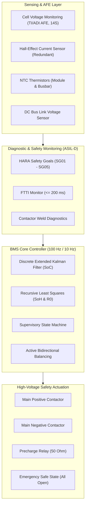

# ISO 26262 Functional Safety Concept (ASIL-D BMS Architecture)

## 1. Executive Summary

This document defines the **Functional Safety Concept (FSC)** and **Technical Safety Requirements (TSR)** for the 14S Lithium-ion Battery Management System (BMS) in accordance with **ISO 26262:2018 (Parts 3, 4, and 6)** for automotive road vehicles.

The system targets high-voltage electric powertrain applications, requiring an overall **ASIL-D** rating (the highest safety integrity level).

---

## 2. Hazard Analysis and Risk Assessment (HARA)

In accordance with **ISO 26262-3: Clause 6**, hazardous events resulting from BMS malfunctions were analyzed under worst-case operational situations.

| Hazard ID | Operational Situation | Hazardous Event | Severity (S) | Exposure (E) | Controllability (C) | ASIL Rating |
| :--- | :--- | :--- | :--- | :--- | :--- | :--- |
| **HZ_01** | High-speed highway driving / Fast charging | Overcharging leading to cell thermal runaway, gas venting, and fire | **S3** (Fatal injuries) | **E4** (High probability) | **C3** (Difficult to control) | **ASIL-D** |
| **HZ_02** | Deep discharge during driving | Overdischarging leading to copper dissolution and internal short circuit | **S3** (Delayed thermal event) | **E3** (Medium) | **C3** (Difficult) | **ASIL-C** |
| **HZ_03** | Rapid acceleration / Regenerative braking | Overcurrent exceeding busbar/cell limits causing insulation destruction | **S3** (Fire / loss of drive) | **E4** (High) | **C3** (Uncontrollable) | **ASIL-D** |
| **HZ_04** | Fast charging / High ambient temperature | Cell over-temperature (>60°C) triggering cascade cell decomposition | **S3** (Vehicle fire) | **E4** (High) | **C3** (Difficult) | **ASIL-D** |
| **HZ_05** | Standby / Key-off mode | Stuck / welded contactor leaving high-voltage bus energized | **S3** (Electrocution risk) | **E3** (Medium) | **C2** (Service technician) | **ASIL-C** |

---

## 3. Safety Goals (SG) & Fault Tolerant Time Interval (FTTI)

| Safety Goal ID | Description | ASIL | Fault Tolerant Time Interval (FTTI) | Safe State |
| :--- | :--- | :--- | :--- | :--- |
| **SG01** | **Prevent Over-Voltage:** No cell shall exceed $V_{cell} \ge 4.25\text{ V}$ for longer than the FTTI. | **ASIL-D** | **200 ms** | Open all contactors, inhibit charging |
| **SG02** | **Prevent Under-Voltage:** No cell shall drop below $V_{cell} \le 2.75\text{ V}$ under sustained load. | **ASIL-C** | **500 ms** | Open main contactors, derate discharge |
| **SG03** | **Prevent Over-Current:** Discharge current shall not exceed $120\text{ A}$ and charge current shall not exceed $25\text{ A}$. | **ASIL-D** | **50 ms** (Hardware trip) / **200 ms** (Software) | Open main contactors within FTTI |
| **SG04** | **Prevent Over-Temperature:** Cell temperature shall not exceed $T_{max} \ge 60^\circ\text{C}$. | **ASIL-D** | **500 ms** | Open contactors, command max cooling |
| **SG05** | **Contactor Weld Protection:** Detect welded contactor within $500\text{ ms}$ upon key-off and inhibit drive restart. | **ASIL-C** | **500 ms** | Latch fault, inhibit precharge sequence |

---

## 4. Technical Safety Requirements (TSR)

### TSR-01: Precharge Sequencing & Inrush Current Suppression
1. Upon vehicle drive request (`Vehicle_Key_ON == 1`), the BMS shall close the **Main Negative Contactor** and **Precharge Relay** simultaneously.
2. The precharge resistor ($R_{precharge} = 50\ \Omega$) limits inrush current into the inverter DC-link capacitor ($C_{link} = 1500\ \mu\text{F}$) to $I_{peak} \le \frac{V_{pack}}{50} \approx 1.1\text{ A}$.
3. The BMS shall monitor $V_{bus}$ vs $V_{pack}$. When $V_{bus} \ge 0.95 \cdot V_{pack}$, the BMS shall close the **Main Positive Contactor** and open the **Precharge Relay** within $20\text{ ms}$.
4. If $V_{bus}$ fails to reach $95\%$ within $t_{timeout} = 500\text{ ms}$, the BMS shall abort precharge, open all contactors, and latch `FAULT_PRECHARGE_TIMEOUT`.

### TSR-02: Welded Contactor Diagnostics
1. In `BMS_STATE_STANDBY`, all contactors are commanded OPEN.
2. The Analog Front-End samples the inverter DC-link bus voltage $V_{bus}$.
3. If $V_{bus} > 10.0\text{ V}$ persists for longer than $150\text{ ms}$, the BMS shall flag `FAULT_CONTACTOR_WELD`, assert high-priority CAN diagnostic frame `0x18FF50F4`, and inhibit subsequent key-on cycles.

### TSR-03: Dynamic Current Derating Envelope
To prevent nuisance safety trips, the BMS calculates proactive linear derating envelopes:
$$\text{Thermal Factor } f_T = \begin{cases} 1.0 & T \le 45^\circ\text{C} \\ \max\left(0.1, 1.0 - \frac{T - 45}{60 - 45}\right) & 45^\circ\text{C} < T < 60^\circ\text{C} \\ 0.0 & T \ge 60^\circ\text{C} \end{cases}$$
The powertrain controller receives dynamic limits $I_{discharge,max} = 80 \cdot f_T$ and $I_{charge,max} = 20 \cdot f_T$ over CAN bus at 100 Hz.

---

## 5. Software Architecture & Verification (ISO 26262-6)

* **MISRA-C:2012 Compliance:** All production algorithms (EKF, State Machine, Balancing) strictly ban dynamic memory allocation (`malloc`, `free`), pointers to non-reentrant structures, and recursion.
* **Deterministic Execution:** The supervisory safety state machine executes in a fixed **10 ms cyclic task** ($100\text{ Hz}$), guaranteeing that any safety violation is detected and acted upon well within the $200\text{ ms}$ FTTI.
* **Back-to-Back Equivalence (MIL vs SIL):** The discrete model in MATLAB/Simulink and the generated/hand-crafted C code produce identical state transitions and SoC estimates with numerical divergence $< 0.05\%$.
